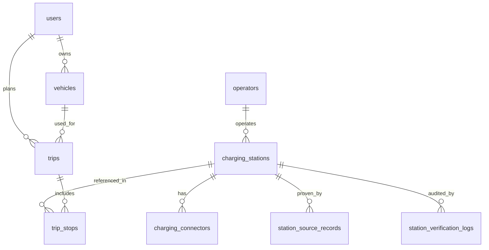

# Database Design — ChargeWise

**Authoritative Storage:** PostgreSQL 16 + PostGIS 3.4  
**User-Facing Realtime & Preference Storage:** Cloud Firestore  
**Identity Provider:** Firebase Authentication

---

## 1. Strict Data Ownership Matrix

| Domain Data | Authoritative Store | Secondary / Cache | Sync Direction |
|---|---|---|---|
| Credentials, email verification, password reset, custom claims (`admin`) | Firebase Authentication | None (never stored in PG/FS) | Firebase Auth → FastAPI (via ID token) |
| User profile (`id`, `firebase_uid`, `email`, `display_name`, `role`, `account_status`) | PostgreSQL (`users`) | Firestore `users/{uid}` mirror of safe display fields | PG → Firestore via `sync_outbox` |
| User preferences & UI settings | Cloud Firestore (`users/{uid}/settings/preferences`) | TanStack Query client cache | Direct scoped client/API R/W |
| Notifications & read/unread state | Cloud Firestore (`users/{uid}/notifications/{id}`) | None | FastAPI Admin SDK writes (via outbox); user updates `read` |
| User activity feed | Cloud Firestore (`users/{uid}/activity/{id}`) | None | FastAPI Admin SDK writes only (via outbox) |
| Opt-in trip updates | Cloud Firestore (`users/{uid}/tripUpdates/{tripId}`) | PostgreSQL `trips` owns itinerary | FastAPI Admin SDK writes only when active |
| Operators, Stations, Connectors, Provenance, Verification, Amenities | PostgreSQL + PostGIS | API HTTP caching | Authoritative in PG only |
| Vehicles & EV Reference Catalog | PostgreSQL (`vehicles`, `ev_vehicle_catalog`) | None | Authoritative in PG only |
| Trips, Route Geometries, Charging Stops | PostgreSQL (`trips`, `trip_stops`) | None | Authoritative in PG only |
| Admin Audit Logs & Outbox Queue | PostgreSQL (`audit_logs`, `sync_outbox`) | None | Authoritative in PG only |

---

## 2. PostgreSQL + PostGIS Entity-Relationship Overview



---

## 3. Core PostgreSQL Tables & Constraints

### `users`
- `id` `UUID PK`
- `firebase_uid` `VARCHAR(128) UNIQUE NOT NULL`
- `email` `VARCHAR(255) UNIQUE NOT NULL`
- `display_name` `VARCHAR(120)`
- `phone` `VARCHAR(32)`
- `role` `VARCHAR(20) NOT NULL DEFAULT 'user'` (`user` | `admin`)
- `account_status` `VARCHAR(20) NOT NULL DEFAULT 'active'` (`active` | `disabled` | `deleted`)
- `created_at`, `updated_at` `TIMESTAMPTZ NOT NULL`
- *No password or credential hash columns.*

### `operators`
- `id` `UUID PK`
- `slug` `VARCHAR(64) UNIQUE NOT NULL`
- `name` `VARCHAR(120) NOT NULL`
- `official_website`, `android_app_url`, `ios_app_url` `TEXT`
- `support_phone`, `support_email` `VARCHAR(120)`
- `payment_information` `TEXT`
- `reservation_support` `VARCHAR(64)` (`supported_in_app` | `partial` | `none` | `unknown`)
- `api_or_ocpi_information` `TEXT`
- `created_at`, `updated_at` `TIMESTAMPTZ NOT NULL`

### `charging_stations`
- `id` `UUID PK`
- `name` `VARCHAR(200) NOT NULL`
- `operator_id` `UUID FK -> operators.id`
- `address` `TEXT NOT NULL`
- `city` `VARCHAR(100) NOT NULL`
- `district` `VARCHAR(100) NOT NULL`
- `state` `VARCHAR(80) NOT NULL DEFAULT 'Karnataka'`
- `latitude` `DOUBLE PRECISION NOT NULL`
- `longitude` `DOUBLE PRECISION NOT NULL`
- `location` `GEOGRAPHY(Point, 4326) NOT NULL` — **GIST Spatial Index**
- `charging_type` `VARCHAR(32) NOT NULL` (`DC_FAST` | `AC` | `MIXED` | `SWAP_OR_2W`)
- `opening_hours` `VARCHAR(160)` (nullable; `"Unknown"` if unconfirmed)
- `pricing_info` `TEXT` (shown only when `pricing_verified = TRUE`)
- `pricing_verified` `BOOLEAN NOT NULL DEFAULT FALSE`
- `amenities_summary` `JSONB NOT NULL DEFAULT '[]'`
- `official_station_url` `TEXT`
- `phone` `VARCHAR(64)`
- `source` `VARCHAR(120) NOT NULL`
- `source_id` `VARCHAR(160) NOT NULL`
- `verification_status` `VARCHAR(32) NOT NULL` — strictly one of:
  1. `listed`
  2. `location_verified`
  3. `operational_status_verified`
  4. `temporarily_unavailable`
  5. `live_availability_confirmed`
  6. `unknown_or_stale`
- `confidence_score` `NUMERIC(4,3) NOT NULL DEFAULT 0.500`
- `last_verified_at` `TIMESTAMPTZ`
- `data_updated_at` `TIMESTAMPTZ`
- `is_active` `BOOLEAN NOT NULL DEFAULT TRUE`
- `created_at`, `updated_at` `TIMESTAMPTZ NOT NULL`
- Indexes: `GIST(location)`, `(state, district, city)`, `(verification_status)`, `(operator_id)`.

### `charging_connectors`
- `id` `UUID PK`
- `station_id` `UUID FK -> charging_stations.id ON DELETE CASCADE`
- `connector_type` `VARCHAR(40) NOT NULL` (`CCS2` | `TYPE_2` | `CHADEMO` | `BHARAT_DC_001` | `BHARAT_AC_001` | `ATHER_PROPRIETARY` | `TYPE_6` | `UNKNOWN`)
- `current_type` `VARCHAR(8) NOT NULL` (`DC` | `AC`)
- `power_kw` `NUMERIC(6,2)` (nullable if unknown; never fabricated)
- `connector_count` `INTEGER NOT NULL DEFAULT 1`
- `operational_status` `VARCHAR(32) NOT NULL DEFAULT 'unknown'` (`operational` | `out_of_service` | `maintenance` | `unknown`)
- `availability_status` `VARCHAR(32) NOT NULL DEFAULT 'unknown'` (`available` | `occupied` | `unknown` | `unavailable`)
- `availability_updated_at` `TIMESTAMPTZ`
- `created_at`, `updated_at` `TIMESTAMPTZ NOT NULL`

### `station_source_records` (Provenance & Deduplication)
- `id` `UUID PK`
- `station_id` `UUID FK -> charging_stations.id ON DELETE SET NULL`
- `source_name` `VARCHAR(120) NOT NULL`
- `source_record_id` `VARCHAR(160) NOT NULL`
- `raw_name`, `raw_operator`, `raw_address` `TEXT`
- `raw_latitude`, `raw_longitude` `DOUBLE PRECISION`
- `raw_payload` `JSONB NOT NULL`
- `dedupe_status` `VARCHAR(32) NOT NULL DEFAULT 'matched'` (`matched` | `pending_review` | `rejected_duplicate` | `new_station`)
- `match_score` `NUMERIC(4,3)`
- `match_breakdown` `JSONB` (coordinate distance score, name similarity, operator match, address token overlap, source ID match)
- `ingested_at` `TIMESTAMPTZ NOT NULL`
- Unique constraint on `(source_name, source_record_id)`.

### Station Deduplication & Confidence Methodology
1. **Candidate Blocking:** PostGIS `ST_DWithin(location, candidate_point, 250)` finds stations within 250 meters.
2. **Multi-Signal Scoring (Weighted Sum, 0.0 – 1.0):**
   - Exact `(source_name, source_record_id)` match → `1.000` (instant deterministic merge).
   - Coordinate proximity (0 m = 1.0 → 250 m = 0.0): weight `0.35`.
   - Operator normalization match (e.g., `"Zeon Network"` == `"Zeon Charging"`): weight `0.25`.
   - Station name normalized token/Levenshtein similarity: weight `0.25`.
   - Address / locality token similarity: weight `0.15`.
3. **Decision Thresholds:**
   - Score `>= 0.82` AND coordinate distance `<= 150 m` → Auto-link provenance record to existing station (updating `data_updated_at` without overwriting higher-confidence verified fields).
   - Score `0.55 – 0.819` → Flag `pending_review` in Admin Duplicate Queue.
   - Score `< 0.55` → Insert as distinct station with `listed` status.
   - Proximity alone (`<= 150 m`) with conflicting operator/name NEVER auto-merges (prevents merging adjacent co-located stations like Nexus Fiza Mall Statiq vs Jio-bp or adjacent dealerships).

### `amenities`
- `id` `UUID PK`
- `name` `VARCHAR(200) NOT NULL`
- `category` `VARCHAR(48) NOT NULL` (`restaurant` | `cafe` | `hotel` | `washroom` | `shopping` | `hospital` | `fuel` | `parking`)
- `address` `TEXT`
- `city` `VARCHAR(100)`
- `latitude`, `longitude` `DOUBLE PRECISION NOT NULL`
- `location` `GEOGRAPHY(Point, 4326) NOT NULL` — **GIST Spatial Index**
- `opening_hours` `VARCHAR(160)` (nullable; UI displays `"Information unavailable"`)
- `rating` `NUMERIC(3,2)` (nullable; never fabricated)
- `family_friendly_tags` `JSONB NOT NULL DEFAULT '[]'`
- `source`, `source_id` `VARCHAR(120)`
- `created_at`, `updated_at` `TIMESTAMPTZ NOT NULL`

### `vehicles` & `ev_vehicle_catalog`
- `vehicles`: `id`, `user_id` FK, `nickname`, `manufacturer`, `model`, `variant`, `model_year`, `battery_capacity_kwh`, `usable_battery_kwh`, `consumption_kwh_per_100km`, `connector_types` (`JSONB`), `max_ac_power_kw`, `max_dc_power_kw`, `charging_curve_json` (`JSONB` nullable), `specs_source` (`oem_verified` | `user_entered` | `estimated`), `is_default` (`BOOLEAN`), `created_at`, `updated_at`.
- Check constraints enforce `usable_battery_kwh <= battery_capacity_kwh`, positive capacity/consumption/power limits, and valid connector types.

### `trips` & `trip_stops`
- `trips`: Stores origin/destination coordinates, `start_soc_pct`, `target_arrival_soc_pct`, `max_stops`, preferences, total distance, estimated drive & charge minutes, energy required, expected arrival SOC, `routing_source`, `route_geojson`, `explanation_summary`, `assumptions_json`, `is_saved`, `created_at`, `updated_at`.
- `trip_stops`: Ordered stops (`stop_order`), `station_id`, `connector_id`, `distance_from_origin_km`, `detour_km`, `arrival_soc_pct`, `departure_soc_pct`, `energy_added_kwh`, `estimated_charge_minutes`, `estimated_power_kw`, `selection_reason`, `alternatives_json`.

### `sync_outbox` & `audit_logs`
- `sync_outbox`: `id`, `aggregate_type`, `aggregate_id`, `target_system` (`firestore`), `idempotency_key` (`UNIQUE`), `payload` (`JSONB`), `status` (`pending` | `dispatched` | `failed`), `attempts`, `last_error`, `created_at`, `dispatched_at`.
- `audit_logs`: `id`, `actor_user_id`, `action`, `entity_type`, `entity_id`, `details` (`JSONB`), `created_at`.

---

## 4. Cloud Firestore Schema

```text
users/{firebaseUid}
  - firebaseUid: string
  - displayName: string
  - email: string
  - photoURL: string | null
  - notificationSettings: map { tripReminders: bool, dataAlerts: bool, emailDigest: bool }
  - createdAt: timestamp
  - updatedAt: timestamp

users/{firebaseUid}/settings/preferences
  - preferredUnits: "metric" | "imperial"
  - preferredMapStyle: "standard" | "terrain"
  - preferredRouteSettings: map { reserveSocPct: number, preferFastChargers: bool, maxDetourKm: number, preferredAmenities: string[] }
  - preferredNotificationSettings: map { tripSaved: bool, stationAlerts: bool }
  - updatedAt: timestamp

users/{firebaseUid}/notifications/{notificationId}
  - title: string
  - message: string
  - type: "trip_saved" | "vehicle_added" | "station_update" | "system"
  - read: boolean
  - createdAt: timestamp
  - relatedEntityId: string | null
  - deepLink: string | null

users/{firebaseUid}/activity/{activityId}
  - type: string
  - title: string
  - description: string
  - createdAt: timestamp
  - relatedEntityId: string | null
  - metadata: map

users/{firebaseUid}/tripUpdates/{tripId}  (written only when trip tracking is active)
  - tripStatus: "planned" | "in_progress" | "completed"
  - currentProgress: number (0..100)
  - lastUpdated: timestamp
  - currentLocation: map { lat: number, lon: number } | null (only with explicit consent)
  - nextChargingStop: map | null
```

---

## 5. Firestore Cost & Performance Controls

Based on current Firebase Spark/Blaze free quotas (**50,000 reads/day, 20,000 writes/day, 20,000 deletes/day, 1 GiB storage**):
- **Zero telemetry in Firestore:** Map markers, route polylines, and station catalogs stay exclusively in PostgreSQL + TanStack Query memory cache.
- **Targeted reads & pagination:** Notifications and activity queries use `limit(20)` + cursor pagination; preferences live in a single document (`settings/preferences`).
- **No unnecessary persistent listeners:** Fetch via FastAPI or bounded React hooks without `onSnapshot` over unbounded collections.
- **No sensitive payload leakage:** Notification documents hold short summaries (`"Trip saved: Mysuru to Mangaluru"`) and `relatedEntityId`—never raw coordinates or private account metadata.
